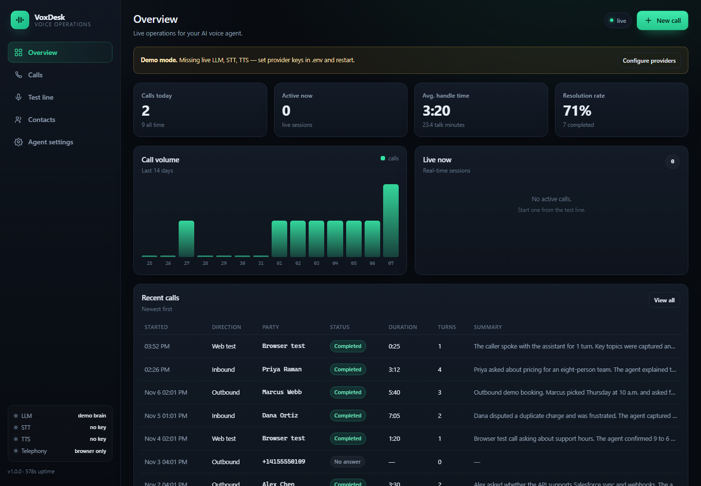

# VoxDesk — LangChain + FastAPI AI voice call assistant

A production-shaped AI phone agent in **Python**, built with **FastAPI** and
**LangChain**, with a real-time voice pipeline, Twilio telephony, streaming
transcripts and an operations dashboard.

It answers real calls, listens with streaming speech-to-text, thinks with a
LangChain chat model (Grok, xKiro, OpenAI, OpenRouter, Groq or any
OpenAI-compatible gateway), speaks with natural text-to-speech, and streams the
conversation to the dashboard — with persistence, post-call summaries and
API-key auth.



> Ported from the Node/TypeScript implementation to Python. The HTTP contract,
> database schema and dashboard are unchanged, so the same clients work.

## Why LangChain here

The conversation is a LangChain **LCEL** pipeline, not a hand-rolled HTTP client:

```python
# app/prompts.py
prompt = ChatPromptTemplate.from_messages([
    ("system", "{system_prompt}"),          # persona + knowledge + guardrails
    MessagesPlaceholder("history"),          # budgeted conversation
])

# app/llm.py
chain = prompt | ChatOpenAI(model=..., base_url=..., streaming=True) | StrOutputParser()

async for token in chain.astream({"system_prompt": ..., "history": [...]}):
    segmenter.push(token)                    # cut speakable sentences as tokens arrive
```

- **`ChatOpenAI` with `base_url`** covers xAI Grok, xKiro, OpenAI, OpenRouter,
  Groq, vLLM and Ollama through one adapter.
- **`JsonOutputParser(pydantic_object=CallSummary)`** turns the end-of-call
  transcript into a validated summary / outcome / sentiment / action items.
- **`DemoChatModel(BaseChatModel)`** is a real LangChain chat model used when no
  key is configured: it streams tokens, supports `astream`, and returns valid
  summary JSON. Every chain, parser and callback therefore works identically in
  demo mode and production.
- **`MessagesPlaceholder` + a character budget** keep the prompt bounded on long
  calls without losing the newest turns.

## Features

- **Real telephony** — Twilio Programmable Voice + bidirectional Media Streams.
  Inbound answering, outbound dialing, carrier hangup, warm transfer via
  `<Dial>`, HMAC-SHA1 webhook validation and HMAC-SHA256 signed media URLs.
- **Full-duplex voice pipeline** — 8 kHz G.711 μ-law ↔ 16 kHz PCM, adaptive VAD,
  barge-in that cancels the LangChain stream and TTS and flushes carrier audio,
  sentence-level TTS chunking, real-time paced 20 ms frames.
- **Provider flexibility** — LLM via LangChain; STT via Deepgram streaming or
  OpenAI batch; TTS via ElevenLabs, OpenAI or Deepgram Aura. Explicit demo
  fallbacks when keys are absent.
- **Phone-grade agent behaviour** — short spoken turns, no markdown, one question
  at a time, editable knowledge base, escalation/privacy guardrails, warm
  transfer, transfer-marker filtering so control tokens are never spoken.
- **Operations dashboard** — live calls, KPIs, 14-day volume, searchable history,
  transcripts, summaries, contacts, agent settings, provider self-tests.
  Zero-build HTML/CSS/JS served by FastAPI.
- **Runnable in production** — SQLite (WAL) via stdlib `sqlite3`, API-key auth
  with timing-safe comparison, rate limiting, CSP/security headers, structured
  logs, graceful shutdown, stale-call reaping, non-root Docker image, health
  endpoint, **44 tests + an end-to-end smoke script**.
- **Demo mode** — no keys needed: boot, open the test line, talk or type.

## Quickstart

Requirements: **Python 3.11+** (tested on 3.13).

```bash
python -m venv .venv
# Windows: .venv\Scripts\activate
source .venv/bin/activate
pip install -r requirements.txt -r requirements-dev.txt
cp .env.example .env          # Windows: copy .env.example .env
python run.py
```

Open <http://localhost:8080>. With no keys the sidebar shows demo providers and a
banner explains what to add. Click **Test line → Start call** and speak (or type)
to the agent.

```bash
python scripts/seed.py --yes    # populate the dashboard with 8 demo calls
pytest -q                       # 44 tests
python scripts/smoke.py         # real server + WebSocket end-to-end call
```

> `run.py` inserts the project root on `sys.path`, so it works even in Python
> distributions that run isolated/safe-path. In a normal environment
> `uvicorn app.main:app --reload` also works.

## Configure providers

```dotenv
# Grok (xAI)
LLM_PROVIDER=xai
XAI_API_KEY=xai-...
LLM_MODEL=grok-4

# xKiro / any OpenAI-compatible gateway
LLM_PROVIDER=custom
LLM_BASE_URL=https://your-gateway.example/v1
LLM_API_KEY=...
LLM_MODEL=...

DEEPGRAM_API_KEY=...        # streaming STT (recommended)
ELEVENLABS_API_KEY=...      # natural voice
```

Auto-detection when `LLM_PROVIDER` is unset:
`XKIRO_API_KEY` → `XAI_API_KEY`/`GROK_API_KEY` → `OPENAI_API_KEY` →
`OPENROUTER_API_KEY` → `GROQ_API_KEY`.

Verify before spending a call:

```bash
python scripts/check_live.py          # LLM + TTS + read-only Twilio check
python scripts/check_live.py --llm    # cheapest
```

## Connect a phone number (Twilio)

1. Buy a voice-capable number.
2. Expose the app over HTTPS (local: `ngrok http 8080`), set
   `PUBLIC_URL=https://<domain>` and restart.
3. Configure:

   ```dotenv
   TELEPHONY_PROVIDER=twilio
   TWILIO_ACCOUNT_SID=AC...
   TWILIO_AUTH_TOKEN=...
   TWILIO_PHONE_NUMBER=+1...
   TWILIO_VALIDATE_SIGNATURE=true
   ```

4. Set the number's **Voice configuration** webhook to
   `https://<domain>/webhooks/twilio/voice`, HTTP POST.
5. Call the number. Twilio fetches TwiML, opens
   `wss://<domain>/media/twilio?callId=…&sig=…`, and the agent speaks.

Outbound: **New call** in the dashboard or `POST /api/calls`.

### Human transfer

Set **Transfer number** in *Agent settings* (E.164). On a Twilio call the agent
speaks a handoff line and the call is redirected with `<Dial timeout="30">`.
The `<<TRANSFER>>` control marker is stripped from speech (even when streamed in
fragments) and only used by the call engine.

## API

All `/api/*` routes require `Authorization: Bearer <key>` or `X-API-Key` when
`API_KEYS` is set. `/api/health` is public.

| Method | Path | Purpose |
| --- | --- | --- |
| GET | `/api/health` | Liveness, provider report, uptime |
| GET | `/api/overview` | KPIs, 14-day volume, recent calls, live sessions |
| GET | `/api/calls?limit&offset&status&q` | Paginated history with search |
| GET | `/api/calls/{id}` | Call + messages + events + live snapshot |
| GET | `/api/calls/{id}/export` | Plain-text transcript |
| POST | `/api/calls` | Place an outbound call `{ to, contactName?, greeting? }` |
| POST | `/api/calls/{id}/hangup` | End a live call |
| POST | `/api/calls/{id}/message` | Inject caller text into a live call |
| GET/PUT | `/api/settings` | Persona, greeting, knowledge, voice, transfer number, limits |
| GET/POST/DELETE | `/api/contacts` | Dial list |
| POST | `/api/providers/test` | Live round trip against LLM or TTS |
| POST | `/webhooks/twilio/voice` | TwiML + stream bootstrap (signed) |
| POST | `/webhooks/twilio/status` | Call status updates (signed) |
| WS | `/media/twilio` | Carrier audio (μ-law 8 kHz, signed) |
| WS | `/ws/test-call` | Browser audio (PCM16 16 kHz) |
| WS | `/ws/live` | Dashboard event stream |

## Architecture

```
                    ┌──────────────────────── VoxDesk (FastAPI) ──────────────────────┐
 Twilio number      │  /webhooks/twilio/voice ──► CallSession ──► LangChain LCEL chain  │
   │  PSTN          │        ▲                        │                │                │
   └── μ-law 8 kHz ─┼─► /media/twilio WS ──► VAD ─────┤                ▼                │
                    │        │            Deepgram ◄──┘        SentenceSegmenter        │
                    │        │                                     │                    │
 Browser test ──────┼────────┘                                TTS provider               │
 PCM16 16 kHz       │                                              │                     │
                    │        paced 20 ms frames ◄──────────────────┘                    │
                    │        SQLite (calls/messages/events) ──► REST + WS dashboard      │
                    └────────────────────────────────────────────────────────────────────┘
```

One turn: 20 ms frames → VAD + STT → 550 ms transcript debounce → LangChain
`astream` → sentence chunking → TTS → paced frames. Barge-in cancels the stream,
TTS tasks and queued audio, then records what was actually spoken.

## Tests

```bash
pytest -q                  # 44 tests
python scripts/smoke.py    # boots uvicorn + drives a real call over WebSocket
```

Coverage includes μ-law/resampling, VAD, segmenter, SQLite store, auth,
settings validation, contacts, transcript export, Twilio signature/TwiML,
outbound call flow against a mock carrier, signed status callbacks, hangup,
the media-stream WebSocket (160-byte μ-law frames, forged signature, unknown
call), the LangChain demo model (streaming, cancellation, structured summary),
and the browser test line end to end.

## Deployment

```bash
cp .env.example .env      # fill in keys; NODE_ENV=production + API_KEYS required
docker compose up -d --build
```

The image runs as UID 10001, uses `/data` for SQLite and exposes a healthcheck.
For bare metal:

```bash
pip install -r requirements.txt
NODE_ENV=production API_KEYS=... python run.py
```

Put nginx/Caddy in front for TLS and set `PUBLIC_URL` to the external HTTPS URL
(required by Twilio and used for `wss://`). Example Caddy:

```
voice.example.com {
  reverse_proxy 127.0.0.1:8080
}
```

### Production checklist

- [ ] `NODE_ENV=production` and a strong, unique `API_KEYS`
- [ ] `PUBLIC_URL` is the public HTTPS origin (no trailing slash)
- [ ] `TWILIO_VALIDATE_SIGNATURE=true`
- [ ] TLS terminated by a proxy (HSTS emitted automatically in production)
- [ ] `DATA_DIR` on a persistent volume; back up `voxdesk.db`
- [ ] Logs shipped from stdout; alert on `/api/health` and provider 5xx
- [ ] Review transcript retention (contains personal data by design)

### Scaling notes

Call state is in-memory per process and SQLite is single-writer. One instance
handles many concurrent calls (provider latency dominates), but horizontal
scaling needs a shared session store/pub-sub and sticky routing for
`/media/twilio`.

## Security

- API-key auth with `hmac.compare_digest`; no cookies, so no CSRF surface.
- Twilio webhook HMAC-SHA1 validation; media sockets require an HMAC-SHA256
  signature bound to the call id.
- Strict CSP, `X-Frame-Options: DENY`, nosniff, permissions policy, HSTS in
  production, request size limits.
- Per-IP/per-key rate limiting on API routes.
- Secrets come only from the environment and are never returned by the API.
- Prompt guardrails forbid collecting card numbers, passwords or one-time codes
  and require escalation for billing, legal, medical or security issues.
- Audio is not recorded to disk by default.

## Project layout

```
app/
  config.py       env parsing, provider resolution, guard rails
  db.py           SQLite WAL schema + queries (stdlib sqlite3)
  audio.py        μ-law, resampling, PCM framing, dBFS
  vad.py          adaptive energy VAD
  segmenter.py    streaming sentence chunker
  prompts.py      ChatPromptTemplate, guardrails, CallSummary, message budget
  llm.py          LangChain ChatOpenAI factory, LCEL chain, DemoChatModel
  stt.py          Deepgram streaming / OpenAI batch / mock
  tts.py          ElevenLabs / OpenAI / Deepgram / demo voice
  telephony.py    Twilio REST, TwiML, signature validation, transfer
  channels.py     Twilio & browser transports, paced audio player
  session.py      call state machine, barge-in, silence handling, summaries
  hub.py          live call registry + event fan-out
  api.py          FastAPI routes, Twilio webhooks, WebSockets, static dashboard
  main.py         ASGI app
public/           zero-build dashboard
tests/            44 pytest tests
scripts/          seed.py, smoke.py, check_live.py
```

## Troubleshooting

| Symptom | Fix |
| --- | --- |
| Dashboard shows "Demo mode" | Missing keys; check `.env`, restart, run `python scripts/check_live.py`. |
| Twilio connects but no audio | `PUBLIC_URL` must be https and reachable; check the signature warning in logs. |
| Agent hears nothing | STT key missing or Deepgram rejected; use the text box to confirm the rest of the pipeline. |
| `AssertionError: python-multipart must be installed` | `pip install python-multipart` (in requirements). |
| Long silence before reply | Lower `LLM_MAX_TOKENS`, use `eleven_flash_v2_5` / Deepgram Aura, keep persona terse. |
| `401` from the dashboard | Paste `API_KEYS` in the login overlay or **Agent settings → Dashboard access**. |
| `SQLITE_BUSY` under load | Single writer process; WAL is on with a 5 s busy timeout. |

## License

MIT.
